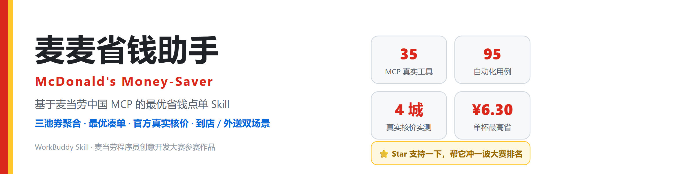
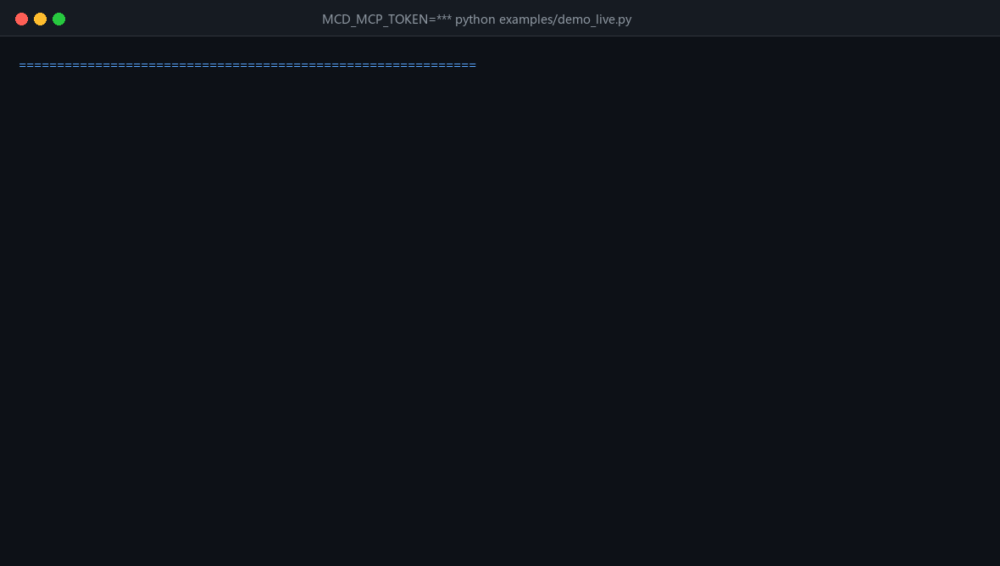
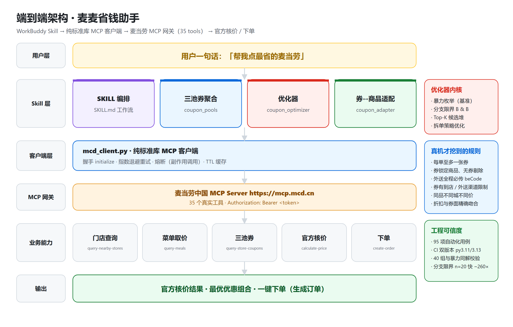
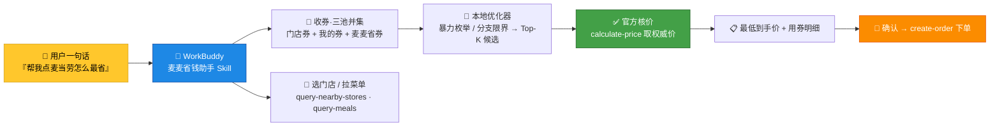

<p align="center">
  
</p>

# 🍔 麦麦省钱助手（McDonald's Money-Saver）

> **麦当劳程序员创意开发大赛参赛作品** · 基于麦当劳中国 MCP 的省钱点餐 Skill
> 一句话自动比券、挑出最优优惠组合、官方核价并下单。

<p align="center">
  <a href="https://github.com/kedamano/mcd-money-saver/stargazers"></a>
  <a href="https://github.com/kedamano/mcd-money-saver/actions/workflows/ci.yml"></a>
  <a href="https://github.com/kedamano/mcd-money-saver/issues"></a>
  
  
  
  
  
</p>

<p align="center">
  <b>⭐ 如果这个项目帮到了你，点个 Star 支持一下，也帮它冲一波大赛排名！</b><br>
  <a href="https://github.com/kedamano/mcd-money-saver">github.com/kedamano/mcd-money-saver</a>
</p>

---

## 🌟 这是什么

「麦麦省钱助手」是一个运行在 [WorkBuddy](https://www.workbuddy.cn) 中的 **Skill（技能）**，
依托**麦当劳中国 MCP Server**（`https://mcp.mcd.cn`，35 个真实工具）的能力，帮你在点麦当劳时
**自动完成**：选门店 → 拉菜单 → 收三池优惠券 → 算最优组合 → 官方核价 → 一键下单。

你只需要说一句话，剩下的比券、凑单、算账它全包了。

---

## 📊 真实数据说话（不是 Demo，是真连）

本项目**真实接入麦当劳 MCP**，跨多城门店跑通端到端链路（2026-10-10 实测）：

<p align="center">
  
</p>

<p align="center"><sub>▲ 真实运行 <code>examples/demo_live.py</code> 的终端实录（2026-10-10 14:22 · 上海悦荟广场店 · 真实 MCP 网关，非录制脚本）</sub></p>

| 环节 | 工具 | 真实结果 |
|---|---|---|
| 取时间 | `now-time-info` | 返回服务器时间（GMT+8）✅ |
| 搜门店 | `query-nearby-stores` | 上海 / 北京 / 广州 / 深圳 **4 城**定位，各取最近门店 ✅ |
| 拉菜单 | `query-meals` | 各店真实现价（上海 121 项 / 广州 129 项，**单价随店而变**）✅ |
| 查券 | `query-store-coupons` | 跨城新人券：中杯美式 7 折 / 中杯奶铁 7 折 ✅ |
| 核价 | `calculate-price` | 多门店多场景对比（见下）✅ |

### 💰 真实核价对比 · 多门店多场景（金额来自官方 `calculate-price`）

> 下面每一行都来自**真实门店 + 真实菜单 + 真实券 + 官方核价**（2026-10-10 实测，非模拟）。

| 城市 · 门店 | 门店编号 | 场景 | 购物车 | 原价 | 用券后 | **省** |
|---|---|---|---:|---:|---:|---:|
| 上海 · 悦荟广场 | `1450104` | 无券基线 | 美式中杯 + 巨无霸 + 中薯条 | ¥39.00 | ¥39.00 | ¥0 |
| 上海 · 悦荟广场 | `1450104` | 中杯美式 7 折券 | 同上 | ¥58.00 | **¥52.30** | **¥5.70** |
| 北京 · 新东安二号 | `1950526` | 无券基线 | 中杯奶铁 + 巨无霸 + 可乐 | ¥36.00 | ¥36.00 | ¥0 |
| 北京 · 新东安二号 | `1950526` | 中杯奶铁 7 折券 | 同上 | ¥57.00 | **¥50.70** | **¥6.30** |
| 广州 · 今日广场 | `1400011` | 无券基线 | 美式中杯 + 巨无霸 + 中薯条 | ¥41.00 | ¥41.00 | ¥0 |
| 广州 · 今日广场 | `1400011` | 中杯美式 7 折券 | 同上 | ¥60.00 | **¥54.30** | **¥5.70** |
| 深圳 · 华强北茂业 | `1421180` | 无券基线 | 美式中杯 + 巨无霸 | ¥25.50 | ¥25.50 | ¥0 |
| 上海 · 悦荟广场 | `1450104` | ⚠️ 双券叠加（负例） | 美式券 + 奶铁券 | — | ❌ 官方拒绝 | `code 600022` |

### 🛵 外送场景（麦乐送）真实核价 · 上海食品一店 `1450056`

> 外送比到店多两步：先建配送地址 → 查外送门店拿 `beCode`；外送价 = **商品 + 配送费 + 打包服务费**。
> 以下为官方 `calculate-price`(beType=2) 真实返回（2026-10-10 实测）。

| 场景 | 购物车 | 原价 | 到手价 | 构成 |
|---|---|---:|---:|---|
| 外送 · 无券 | 汉堡包×2 + 麦咖啡奶铁 + 脆薯饼 | ¥69.50 | **¥62.40** | 商品 ¥53.40 + **配送费 ¥6.00** + **打包费 ¥3.00** |
| 外送 · 到店专用券（负例） | 美式中杯 + 新人 7 折券 | — | ❌ 官方拒绝 | `code 600012` 当前优惠券不可用 |
| 到店 · 同券（对照） | 美式中杯 + 新人 7 折券 | ¥19.00 | **¥13.30** | 券优惠 −¥5.70 |

> 同一张券**到店可用、外送被拒**；外送每单固定多出配送费与打包费——这正是本 Skill
> 提供 **拆分下单**（`optimize_split_orders`）时要权衡的真实成本。

### 🍟 套餐比券更猛：真实「套餐 vs 单点」（省钱下界）

> 真机实测才发现：**套餐才是最大的省钱空间**——单张券最多省 ¥6.30，而套餐动辄省 ¥10+。
> 下表来自上海悦荟广场 `1450104` 的真实菜单 + `query-meal-detail`（2026-10-10 实测）。
> 口径保守：单点合计**只累计能和菜单对上编码的组件**，故为**节省下界**（真实 ≥ 此值）。

| 套餐 | 单点合计 | 套餐价 | **至少省** | 幅度 |
|---|---:|---:|---:|---:|
| 「苹」水相「鱼」套餐 | ¥54.00 | **¥36.00** | **¥18.00** | 33.3% |
| 培根安格斯厚牛堡四件套 | ¥48.00 | **¥37.00** | **¥11.00** | 22.9% |
| 龙焰鸡腿堡三件套 | ¥37.50 | **¥26.90** | **¥10.60** | 28.3% |
| 龙焰芝士棒鸡腿堡三件套 | ¥40.50 | **¥29.90** | **¥10.60** | 26.2% |
| 板烧鸡腿堡四件套 | ¥37.00 | **¥28.00** | **¥9.00** | 24.3% |

> 代码：`combo_optimizer.rank_combo_deals` / `optimize_purchase`——在「买套餐 / 单点」之间
> 求全局最低价；`plan_order_with_combos` 再把**套餐**与**券**二选一取更省。

### 🏪 多店比价：同城同品不同价，别只去最近那家

> 真机实测（上海南京东路商圈，`query-nearby-stores` searchType=2）：**同一件中薯条
> 在不同门店差 ¥1.00**（多数店 ¥13.50，食品一店 `1450056` ¥14.50）。买「中薯条 + 鲜萃咖啡」：

| 门店 | 距离 | 到手价 |
|---|---:|---:|
| 上海黄浦悦荟广场 `1450104` | 194 m | **¥23.00** ✅ |
| 上海黄浦恒基名人购物中心 `1450449` | 230 m | ¥23.00 |
| 上海黄浦福州路上海书城 `1450556` | 325 m | ¥23.00 |
| 上海福州路 `1450441` | 603 m | ¥23.00 |
| 上海食品一店 `1450056` | 496 m | ¥24.00 ⚠️ |

> 代码：`store_optimizer.optimize_across_stores`——在**可接受距离内**比较多家门店到手价，
> 求最低并量化「为省这笔钱要多走多少米」，不盲目推荐远店。

### 🔍 真机才挖得到的 8 条真实业务规则

1. **每单仅限一张券** — 一单同时传两张券，官方直接返回 `code=600022「暂不支持多张券使用」`。→ 本 Skill 的**真实核价路径默认 `max_coupons_per_order=1`**（`two_stage_optimize`），本地粗排同样遵守，避免排出官方必然拒绝的组合。
2. **券锁定商品会被静默剔除** — `9900000119 美式中杯`、`9900000117 中杯奶铁` 是**券锁定商品**：无券时 `calculate-price` 直接把它们踢出订单（上海 ¥58 → ¥39、深圳只剩 ¥25.50 的巨无霸）。这正是本 Skill 用 `product_codes` 做「券 ↔ 商品」精确绑定、并**先绑定商品再核价**的现实依据。
3. **同品不同城不同价** — 巨无霸：上海 ¥25.50 / 北京 ¥26.50；中薯条：上海 ¥13.50 / 广州 ¥14.50。→ 所以**必须按门店实时菜单取价**，绝不能用全局价目表。
4. **折扣与券面精确吻合** — 美式中杯 ¥19.00 × 0.7 = ¥13.30（`discount=570` 分）；中杯奶铁 ¥21.00 × 0.7 = ¥14.70（`discount=630` 分），服务端权威价与本地模型一致。
5. **券有渠道限制** — 标注「到店专用」的券（如新人专享 7 折）用于外送核价返回 `code=600012「当前优惠券不可用！」`，到店则正常生效。→ 选券必须校验 `orderType`，否则会报出"算得省、下单废"的假方案。
6. **外送链路全程要 `beCode`** — 外送(beType=2)下 `query-meals` / `query-store-coupons` / `calculate-price` 不传 `beCode` 一律返回 `code=600048「必传beCode」`；`beCode` 来自 `delivery-query-stores`（须先 `delivery-create-address` 建地址）。外送商品 `code` 与到店**不通用**（到店下单会报 `60006 不可售`）。
7. **促销对企业团餐专属** — `query-promotions` 返回的 12 条规则 `beTypes` **全部为 `["6"]`（企业团餐）**，普通到店/外送拿不到。→ 本项目**诚实地不把促销当卖点**，省钱候选收缩为真实可用的「券 + 套餐」。
8. **`auto-bind-coupons` 返回纯文本而非 JSON** — 误用 `call_tool` 会抛「text 中未找到业务 JSON」，必须用 `call_tool_text`；这正是它此前长期没被接进来的根因。实测领取后**门店券 2→3、我的券 2→7**（白拿 5 张）。

**自动化验证**：`pytest` 回归 **142 用例**（离线 **137 passed** + 真实 live **4** + 1 例真实下单受保护默认跳过）。其中 `test_live_end_to_end` 走项目自带 Python 客户端（`mcd_client.py`，纯标准库）真实连通 `initialize → list_tools(35) → now-time-info`；`test_live_calibration` 用真实返回值校准本地价格模型与官方一致；`test_scale_pruning` / `test_topk_pruning` 以 40 组随机用例证明**分支限界与暴力枚举同解**（单最优 + Top-K 两条路径）；`test_one_coupon_rule` 锁定**每单至多一张券**；`test_split_orders` 验证**拆分下单**（含外送配送费权衡）；`test_delivery_contract` 锁定**外送配送费/打包费构成与券渠道限制**；`test_auto_bind` 锁定**领券扩池**；`test_combo_optimizer` 以暴力基准验证**套餐最优购买**；`test_store_optimizer` 验证**多店比价 + 距离权衡**；`test_promotions_scope` 锁定**促销仅企业团餐**的真实结论。

> 🎬 **想看完整真实链路？** 运行 `MCD_MCP_TOKEN=xxx python examples/demo_live.py`，
> 一条命令跑通「时间 → 门店 → 菜单 → 优惠券 → 官方核价」，样例输出见 [`DEMO.md`](DEMO.md)。

---

## 🏗️ 端到端架构

<p align="center">
  
</p>

<details>
<summary>文本版流程图（Mermaid，可编辑）</summary>



</details>

### 🔍 两阶段核价模型（为什么结果可信）

很多"比券工具"只算本地、下单才发现不对。本 Skill 用**两阶段**堵住这个坑：

| 阶段 | 做什么 | 特点 |
|---|---|---|
| **① 本地求解（毫秒级）** | 小券池（≤16 张）暴力枚举所有叠加组合；大券池自动切**分支限界**（先剔 0 优惠券，再按乐观上界剪枝），在「门槛校验 + 订单级券至多一张 + 免配送费券至多一张」约束下求 Top-K 最低价候选 | 0 网络开销；券数大也可扩展 |
| **② 官方核价（权威）** | 仅对 Top-K 候选调用麦当劳 `calculate-price`，取官方返回的真实价 | 以官方为准，杜绝"算得美、下单贵" |

> 实测：阶段①本地最优与阶段②官方核价**完全一致**（美式 7 折 19×0.7=13.30），模型与服务端真实行为对齐。

---

## ✨ 功能亮点

| 能力 | 说明 |
|---|---|
| 多池并集比券 | 门店券、我的券、麦麦省券三池聚合；**真机实测三池返回结构不同**（门店券为结构化 JSON 可核价，我的券/麦麦省券为 Markdown 需解析），按券名去重、标注可领取扩池 |
| 最优叠加组合 | 满减 / 折扣 / 立减 / 免配送费 自动求最低价；**大券池走分支限界**（n=20 时较暴力枚举快 ~260×，与暴力枚举**同解**）|
| 🔀 **拆分下单** | 真实「每单一张券」下，把购物车拆成多单、每单配一张最优券，并权衡外送多出的配送费，求**全局最低价**（`optimize_split_orders`，含与暴力基准同值校验）|
| 🛵 **到店 / 外送双场景** | 外送链路（建地址 → 外送门店 `beCode` → 含配送费/打包费核价）完整支持，并校验券渠道（到店专用券外送自动排除）|
| 🍟 **套餐纳入优化** | 不只比券：把「买套餐」作为候选方案，在「套餐 / 单点」间求全局最低价（真实套餐最多省 **¥18.00**）；`plan_order_with_combos` 将套餐与券二选一 |
| 🏪 **多店比价 + 距离权衡** | 不再只取最近店：在可接受距离内比较多家门店同品价格×券，求最优并量化「多走几米省几元」（实测同城同品差 ¥1.00）|
| 🎫 **一键领券扩池** | 真实接入 `auto-bind-coupons`（`call_tool_text` 解析纯文本），领券后自动重查三池再比价；实测我的券 2→7 |
| 类目 & 互斥约束 | 支持类目限定券；订单级券至多一张，贴合真实规则 |
| 🅱️ **产品级绑定** | 券按 `product_codes` 精确匹配，错配自动失效（券锁定商品也能正确处理）|
| 🅲️ **凑单建议** | 距满减门槛差 X 元时，反推最小代价加购组合，净亏不推 |
| 🅳️ **两阶段核价** | 本地枚举 Top-K → 仅少量候选调官方 `calculate-price` 取权威价 |
| 🅴️ **时效与库存** | 过期券自动剔除、**未生效/每日时段窗**（如仅 05:00-23:59 可用）校验、不可售商品提示移出优惠范围 |
| 官方核价兜底 | 用 `calculate-price` 校验，避免"算得美、下单贵" |
| 🛡️ **健壮性** | MCP 偶发 404/5xx/429 **自动重试 + 熔断**（下单等副作用调用禁用重试）；门店/菜单/券 **TTL 缓存**；`scripts/doctor.py` 一键排查配置坑 |

---

## 🚀 WorkBuddy 一键使用

### 1️⃣ 接入麦当劳 MCP（复制粘贴即可）

左侧 **【专家·技能·连接器】→【连接器】→【自定义连接器】→【配置 MCP】**，粘贴：

```json
{
  "mcpServers": {
    "mcd-mcp": {
      "type": "streamable-http",
      "url": "https://mcp.mcd.cn",
      "headers": {
        "Authorization": "Bearer ${MCD_MCP_TOKEN}"
      }
    }
  }
}
```

> ⚠️ **`type` 必须是 `streamable-http`（带连字符）**，否则会卡在"需要认证"无法连接。
> Token 来自 https://open.mcd.cn/mcp （手机号登录 → 控制台 → 激活 → 复制）。**严禁将真实 Token 提交进仓库**，仓库内仅保留脱敏示例 `mcp-config.example.json`。

### 2️⃣ 安装本 Skill

将本仓库克隆后，把 `SKILL.md` 与 `src/` 放入 WorkBuddy 的**用户技能目录**（参考 WorkBuddy 官方文档的 Connector / Skill 说明），或在对话中直接引用本仓库的 `SKILL.md`。

### 3️⃣ 开聊（三种触发都是它）

在 WorkBuddy 对话框里直接说：

- "帮我点一份麦当劳，怎么最省钱？"
- "附近麦当劳有什么优惠券能用，帮我凑个最划算的套餐"
- "我想点巨无霸+薯条+可乐，外送到家，帮我比券"

助手会自动走完 **选店 → 选品 → 比券 → 核价 → 下单** 全流程，并汇报：
`原价 ¥71.0 → 用券后 ¥54.0，省 ¥17.0（组合：满60减12 + 小食减5）`。

---

## 🧪 本地验证（无需 Token）

核心算法与真实接口解析均可离线测试，不依赖麦当劳 MCP：

```bash
python -m pytest tests/ -q                 # 离线：137 例全过（含真实合同测试）
python scripts/doctor.py                   # 环境自检：查 mcp.json 的 type / Token 前缀
python src/coupon_optimizer.py             # 内置演示（基础优化器）
python examples/demo_smart.py              # B/C/D/E 离线演示
MCD_MCP_TOKEN=xxx pytest -m live -q        # 可选：真实端到端冒烟（initialize→list_tools→call_tool）
MCD_MCP_TOKEN=xxx python examples/demo_live.py           # ⭐ 真实端到端演示（选店→拉券→官方核价）
MCD_MCP_TOKEN=xxx python examples/demo_advanced.py       # ⭐ 进阶：领券扩池 + 套餐省钱 + 多店比价
MCD_MCP_TOKEN=xxx python examples/demo_smart.py --live   # D 两阶段真实官方核价演示
```

---

## 📁 仓库结构

```
mcd-money-saver/
├── SKILL.md                    # WorkBuddy Skill 定义（省钱工作流）
├── README.md                   # 本文件
├── SPEC.md                     # 规格说明书（SDD，含真实业务规则与验收标准）
├── CONTEST_DECLARATION.md      # 参赛声明（官方原文，不可改）
├── MCP_INTEGRATION.md          # 麦当劳 MCP 集成说明
├── mcp-config.example.json     # 脱敏 MCP 配置示例（仅环境变量占位符）
├── LIVE_TEST_LOG.md            # 真实 MCP 端到端测试报告
├── DEMO.md                     # 真实端到端演示样例输出（可截图）
├── workbuddy.md                # WorkBuddy 联动开发上下文（专项奖励核验）
├── src/
│   ├── coupon_optimizer.py     # 最优组合优化器（暴力枚举 / 分支限界双策略 + B/E + rank_candidates）
│   ├── coupon_adapter.py       # 真实券 JSON -> 领域 Coupon（含 product_codes/expires_at）
│   ├── coupon_pools.py         # 三池聚合：门店券(JSON) / 我的券 / 麦麦省券(Markdown) 解析
│   ├── coupon_smart.py         # C 凑单建议 + D 两阶段校验（智能决策增强）
│   ├── combo_optimizer.py      # 🍟 套餐优化：套餐 vs 单点求最低价 + 套餐/券二选一
│   ├── store_optimizer.py      # 🏪 多店比价 + 距离权衡（同城同品不同价）
│   └── mcd_client.py           # 麦当劳 MCP 真实客户端（含 price_combo 官方核价）
├── tests/
│   ├── test_coupon_optimizer.py# TDD 测试契约（基础优化器）
│   ├── test_enhancements.py    # B/C/D/E 契约测试
│   ├── test_real_contract.py   # 真实合同测试（基于 fixtures 黄金基准）
│   ├── test_coupon_pools.py    # 三池 Markdown 解析 + 聚合测试
│   ├── test_time_window.py     # 生效时间 / 每日时段窗过滤测试
│   ├── test_scale_pruning.py   # 大规模券剪枝 + 分支限界（与暴力枚举同解 + 性能）
│   ├── test_topk_pruning.py    # Top-K 候选的分支限界（rank_candidates 与暴力枚举同值）
│   ├── test_split_orders.py    # 拆分下单：与暴力基准同值 + 外送配送费权衡
│   ├── test_delivery.py        # 外送链路请求体构造（地址/门店/beCode，离线）
│   ├── test_delivery_contract.py# 外送真实返回契约（配送费/打包费/券渠道限制）
│   ├── test_auto_bind.py       # 一键领券扩池（call_tool_text + 前后对比）
│   ├── test_combo_optimizer.py # 套餐 vs 单点（与暴力基准同解 + 真实节省下界）
│   ├── test_store_optimizer.py # 多店比价 + 距离权衡 + 门店券解析
│   ├── test_promotions_scope.py# 真实结论：促销仅企业团餐（beTypes=["6"]）
│   ├── test_live_calibration.py# 本地价格模型 vs 官方核价（live 校准）
│   ├── test_mcd_client.py      # 客户端解析单测 + 可选真实冒烟(-m live)
│   └── fixtures/               # 真实 calculate-price 返回 + 真实菜单目录（脱敏）
├── examples/
│   ├── demo_smart.py           # B/C/D/E 端到端演示（离线 / --live）
│   ├── demo_live.py            # ⭐ 真实 MCP 端到端演示（选店→拉券→官方核价）
│   └── demo_advanced.py        # ⭐ 进阶：领券扩池 + 套餐省钱 + 多店比价
├── .github/workflows/ci.yml    # GitHub Actions：每次 push 自动跑离线测试
├── scripts/
│   ├── doctor.py               # 环境自检：排查 mcp.json type / Token 前缀 / 握手
│   └── build_assets.py         # 生成本 README 视觉素材（hero / 架构图 / 终端实录，可复现）
├── docs/assets/                # README 视觉素材：hero.png · architecture.png · pipeline-live.gif
├── conftest.py / pytest.ini    # pytest 路径与标记配置
└── references/
    └── mcp_tools.md            # 省钱场景 MCP 工具参考
```

---

## 📜 免责声明

本项目为麦当劳程序员节创意开发大赛**参赛作品**，由作者独立开发，**非麦当劳官方产品**。
项目输出仅供参考，餐品信息、价格及供应状态以麦当劳官方渠道实时结果为准；不构成
医疗、营养或其他专业建议。详见 `CONTEST_DECLARATION.md`。

---

<p align="center">
  <b>🍔 觉得有用？<a href="https://github.com/kedamano/mcd-money-saver">点个 Star</a> 支持作者冲大赛排名！</b>
</p>
